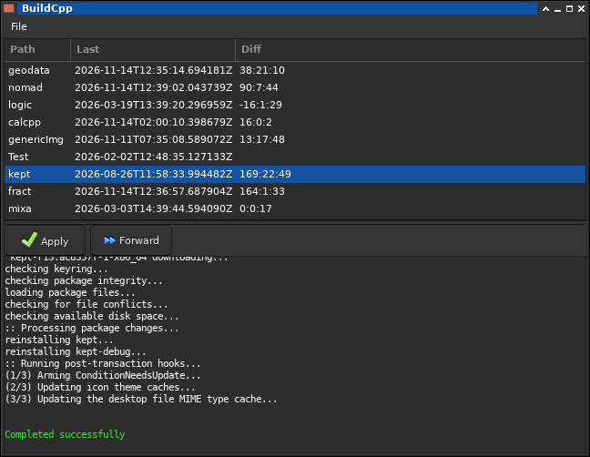

# buildCpp

A simple build tool using meson & pacman.

## Linux
To build on (Lin)ux use :

As prerequisite genericImg is required so build/install this first:

to build use:
<pre>
meson setup build -Dprefix=/usr
cd build
meson compile
</pre>

The install/pacman step needs askpasscpp installed,
so this can't be tested from rundir 
(Alternative: use other graphical password util, in buildcpp.conf). 

### Windows

Untested may need to switch:
<pre>
LineReaderData -> LineReaderChannel
</pre>